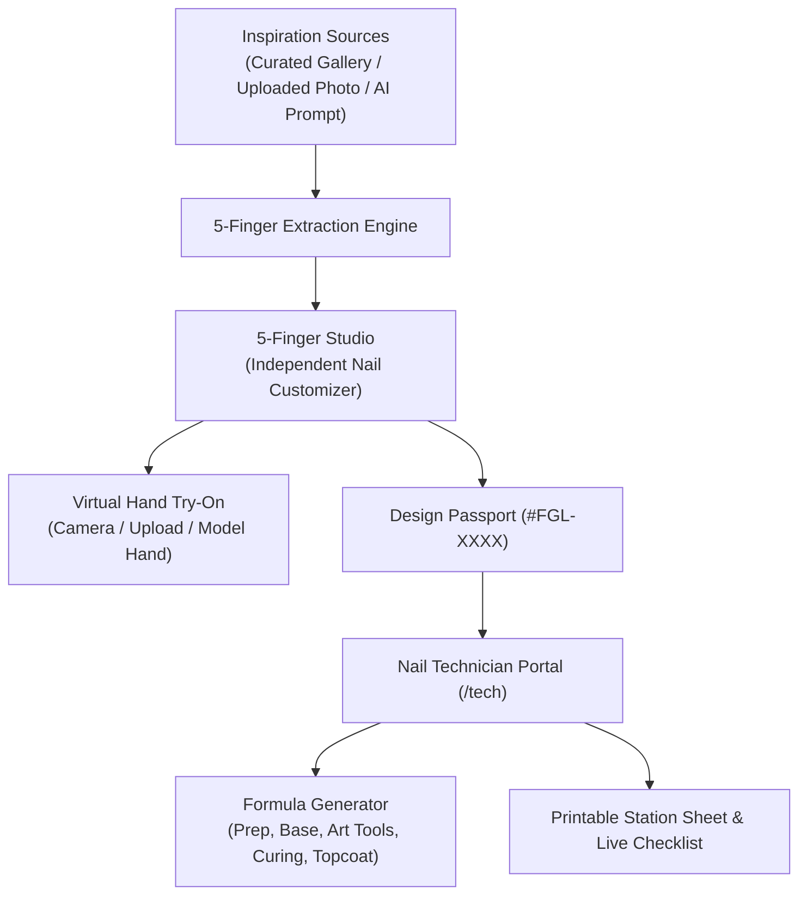
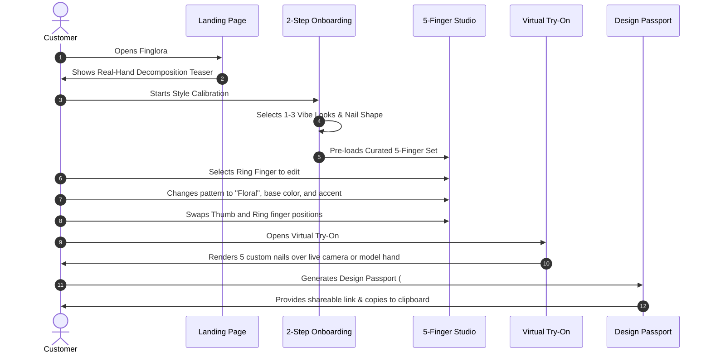
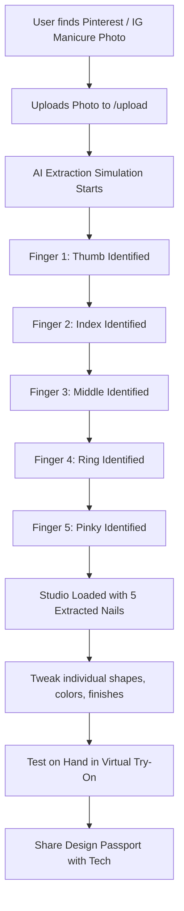
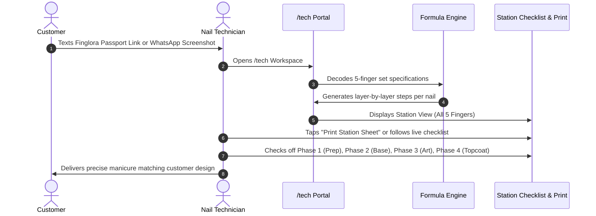

# Finglora — Comprehensive Project Specification, Architecture & User Flows

> **Tagline:** *Love a manicure? Make every finger yours.*  
> **Mission:** Transform real-hand nail inspiration into customizable individual nail designs, realistic on-hand virtual try-ons, and production-grade step-by-step guides for nail technicians.

---

## 📑 Table of Contents

1. [Executive Summary & Core Problem](#1-executive-summary--core-problem)
2. [High-Level Product Architecture](#2-high-level-product-architecture)
3. [The 4 Core Product Surfaces](#3-the-4-core-product-surfaces)
   - [Surface 1: Marketing Landing Page (`/`)](#surface-1-marketing-landing-page)
   - [Surface 2: 2-Step Style Calibration Onboarding (`/onboarding`)](#surface-2-2-step-style-calibration-onboarding)
   - [Surface 3: Customer Web App](#surface-3-customer-web-app)
   - [Surface 4: Nail Technician Web App (`/tech`)](#surface-4-nail-technician-web-app-tech)
4. [Domain Data Model & TypeScript Types](#4-domain-data-model--typescript-types)
5. [Procedural SVG Nail & Hand Engine](#5-procedural-svg-nail--hand-engine)
6. [Technician Formula & Step Generation Logic](#6-technician-formula--step-generation-logic)
7. [End-to-End User Flows (Mermaid Diagrams)](#7-end-to-end-user-flows)
   - [User Flow 1: Customer Discovery & Customization](#user-flow-1-customer-discovery--customization)
   - [User Flow 2: Pinterest / Instagram Hand Photo Extraction](#user-flow-2-pinterest--instagram-hand-photo-extraction)
   - [User Flow 3: Salon Technician Execution & Station Guide](#user-flow-3-salon-technician-execution--station-guide)
8. [Project File Tree & Modular Layout](#8-project-file-tree--modular-layout)
9. [Integration & Extensibility Roadmap](#9-integration--extensibility-roadmap)
10. [Maintenance & Documentation Contract](#10-maintenance--documentation-contract)

---

## 1. Executive Summary & Core Problem

### The Problem
When people look for manicure inspiration on Pinterest, Instagram, or TikTok, they encounter images of manicures modeled on complete hands. However:
1. **No Individual Finger Customization:** You might love the French tip on the thumb, but want a floral ring accent, or dislike the coffin shape on your short natural nail bed.
2. **Skin Tone & Nail Bed Mismatch:** What looks striking on porcelain skin with long acrylic extensions often looks completely different on warm olive or rich espresso skin with short natural nails.
3. **Communication Gap with Nail Technicians:** Clients show their nail artist a blurry photo on their phone. The technician has to guess the pigments, blooming gel techniques, cure durations, and apex structure, leading to inconsistent salon results.

### The Finglora Solution
Finglora acts as the bridge between inspiration and salon reality:
* **Real-Hand Extraction:** Automatically segments hand manicure photos into 5 distinct, editable nail designs (Thumb, Index, Middle, Ring, Pinky).
* **5-Finger Studio:** Customize each nail independently (shape, length, pattern, finish, base color, accent color) with single-finger isolated regeneration, undo history, and swapping.
* **Realistic Hand Try-On:** Test the five-finger set live on camera, on uploaded hand photos, or across diverse procedural skin tone models.
* **Design Passport & Tech Portal:** Generates a unique shareable passport code (`#FGL-XXXX`) and produces technical layer-by-layer formulas with tool specifications and LED curing times for nail artists.

---

## 2. High-Level Product Architecture



---

## 3. The 4 Core Product Surfaces

### Surface 1: Marketing Landing Page (`/`)
* **Hero Section:** Clear value proposition with animated before/after preview showing a single hand photo decomposing into 5 standalone nail cards.
* **Interactive Teaser:** Visitors can tap any of the 5 extracted nails on the landing hero to immediately experience single-nail focus and transition directly into the customization studio.
* **Audience Splitting:** Direct callouts for both manicure enthusiasts ("Browse Hand Inspiration") and professional nail artists ("For Nail Technicians").

### Surface 2: 2-Step Style Calibration Onboarding (`/onboarding`)
* **Step 1 — 15-Second Vibe Check:** The user selects 1 to 3 manicure sets from curated style archetypes (Floral, Chrome, French, Minimal, Bold).
* **Step 2 — Default Nail Shape:** Selects their everyday preferred nail shape (`almond`, `square`, `coffin`, `oval`).
* **Instant Calibration:** The studio automatically adopts the top-selected aesthetic and reformats all five nails into the chosen shape.

### Surface 3: Customer Web App
The customer experience features seven dedicated subviews:
1. **Home Hub (`/home`)**:
   * Displays the active 5-nail set mapped directly onto a curated model hand.
   * "Describe your dream set" AI natural-language prompt field.
   * Quick access to try-on, studio editing, and style tuning.
2. **Explore Gallery (`/explore`)**:
   * Searchable and filterable feed of real-hand manicures across categories.
   * Like and save buttons for favoriting looks.
   * "Extract 5 Nails" action that loads any look into the studio.
3. **Upload Inspiration (`/upload`)**:
   * Drag-and-drop zone for Pinterest screenshots or camera roll photos.
   * 5-step animated progress bar demonstrating finger segmentation (Thumb → Index → Middle → Ring → Pinky).
4. **5-Finger Studio (`/studio`)**:
   * **5 Independent Nail Cards:** Visual preview, title, shape, finish, and extraction status.
   * **Swap Mode:** Allows users to tap two fingers to swap their positions (e.g., move ring finger accent to thumb).
   * **Single-Finger Inspector:** Deep edit mode for the active finger with style pattern presets (Solid, Classic French, Aura, Floral, Chrome Swirl, Glitter Ombré, Minimal Line), dual color pickers (Base & Accent), length, shape, and finish.
   * **Isolated Regeneration:** Regulates random variations on *one finger only*, leaving the other four untouched.
   * **Per-Finger Undo:** Maintains an independent history stack for every individual finger.
   * **Apply-to-All Dialog:** Quick option to copy a favorite style across all five fingers.
5. **Virtual Hand Try-On (`/tryon`)**:
   * **Live WebRTC Camera:** Real-time camera stream with finger positioning guide and snapshot capture.
   * **Custom Photo Upload:** Allows users to upload their own hand with scaling slider (70%–135%) and vertical offset slider (-60px to +60px).
   * **Sample Model Hand:** Procedural vector hand supporting 4 skin tones, bare hand vs. manicured before/after toggling, and zoom inspection.
6. **Design Passport (`/passport`)**:
   * Formatted shareable card with a unique passport code (e.g. `#FGL-8492`) and shareable link (`finglora.app/p/FGL-8492`).
   * High-contrast breakdown of all 5 fingers.
   * One-click clipboard copy and preview link for the nail technician.
7. **Customer Account (`/signup`)**:
   * Clean registration form saving session sets to local storage and browser profile.

### Surface 4: Nail Technician Web App (`/tech`)
* **Tech Workspace (`/tech/workspace`)**:
  * Input field to paste client Design Passport codes.
  * Direct upload option for WhatsApp or Instagram photos texted by clients.
* **Step-by-Step Execution Guide (`/tech/guide`)**:
  * Generated 4-phase technical formula for every finger:
    1. *Prep & Shape*: Cuticle clean, natural nail etching, apex extension geometry.
    2. *Base Layer*: Slip layer, base shade, structural building.
    3. *Art & Pattern*: Specific tools (e.g., 7mm liner brush, dotting tool, ombré sponge, blooming gel) with client notes.
    4. *Topcoat & Finish*: Topcoat specification (high-shine glass, velvet matte, chrome powder burnish, clear leveling builder) and curing times (e.g., 60s LED).
  * Interactive checklist with persistent strike-through for station tracking.
  * Station view tabs (All 5 Fingers vs. Single Finger focus).
  * Print Station Sheet button formatted for salon printing.
* **Technician Registration (`/tech/signup`)**:
  * Professional profile tracking artist name, salon/studio name, specialty, and preferred gel systems.

---

## 4. Domain Data Model & TypeScript Types

Located in [**`types/nail.ts`**](file:///home/alazar/Desktop/Finglora/types/nail.ts):

```typescript
export type Finger = 'thumb' | 'index' | 'middle' | 'ring' | 'pinky';
export type NailShape = 'almond' | 'coffin' | 'oval' | 'square' | 'stiletto';
export type NailLength = 'short' | 'medium' | 'long';
export type NailFinish = 'glossy' | 'matte' | 'chrome' | 'glitter';
export type NailPattern =
  | 'solid'
  | 'classic-french'
  | 'aura'
  | 'floral'
  | 'chrome-swirl'
  | 'glitter-ombre'
  | 'minimal-line';

export interface SkinTonePreset {
  id: string;
  name: string;
  skin: string;
  shadow: string;
  highlight: string;
}

export interface NailDesign {
  finger: Finger;
  title: string;
  baseColor: string;
  accentColor: string;
  pattern: NailPattern;
  shape: NailShape;
  length: NailLength;
  finish: NailFinish;
  clientNote: string;
  status: 'detected' | 'edited';
}

export interface ExploreDesignSet {
  id: string;
  passportCode: string;
  title: string;
  category: string;
  subtitle: string;
  photoUrl: string;
  likes: number;
  isSaved: boolean;
  skinTone: SkinTonePreset;
  backdrop: string;
  chairMinutes: number;
  nails: Record<Finger, NailDesign>;
}

export interface TechStep {
  num: number;
  phase: string;
  text: string;
  tool: string;
  cure: string;
}
```

---

## 5. Procedural SVG Nail & Hand Engine

### Nail Geometry Calculation (`NailCanvasPreview.tsx`)
Nails are generated dynamically via SVG path vectors rather than raster images:
* **Length Scaling:** Short ($0.78\times$), Medium ($0.96\times$), Long ($1.14\times$).
* **Shapes:**
  * `square`: Straight vertical borders with rounded corner radii ($r=5$).
  * `coffin`: Symmetrical inward taper towards the flat free edge.
  * `almond`: Tapered parabolic curve peaking at the central apex.
  * `oval`: Elliptical continuous arc along the tip radius.
  * `stiletto`: Sharp triangular apex convergence.
* **Surface Rendering:**
  * Dynamic clipping paths (`clipPath`) to ensure patterns stay within the nail boundary.
  * Multi-layer procedural effects: Radial gradients for Aura, SVG groups for floral petals, cubic Bézier ribbon strokes for Chrome Swirls, and light reflection specular curves for Glossy topcoats.

### Anatomical Hand Placement (`EditorialHandVisual.tsx`)
The hand renderer positions each finger along anatomical joint vectors:
* **Thumb:** Offset `(74, 232)`, $-34^\circ$ rotation, scale $0.92$.
* **Index:** Offset `(132, 112)`, $-11^\circ$ rotation, scale $0.95$.
* **Middle:** Offset `(188, 84)`, $0^\circ$ vertical rotation, scale $1.00$.
* **Ring:** Offset `(244, 102)`, $+9^\circ$ rotation, scale $0.94$.
* **Pinky:** Offset `(294, 148)`, $+20^\circ$ rotation, scale $0.82$.
* **Orientation Inversion:** Hand SVG supports seamless flipping between Right and Left hands via SVG group horizontal scaling (`transform="scale(-1, 1)"`).

---

## 6. Technician Formula & Step Generation Logic

Located in [**`utils/tech-formula.ts`**](file:///home/alazar/Desktop/Finglora/utils/tech-formula.ts):

| Phase | Formula Logic | Tool Specification | Curing Requirement |
| :--- | :--- | :--- | :--- |
| **Phase 1: Prep & Extension** | Dry e-file Russian cuticle prep with diamond flame bit, 240-grit de-shine, 99% isopropanol dehydration, acid-free primer, and apex extension | `Diamond Flame Bit • 180/240 Grit File • Acid-Free Primer` | 30s LED Flash |
| **Phase 2: Rubber Base & Apex** | Self-leveling rubber base / builder coat establishing reinforced apex 1/3 down from eponychium, inverted 5s to center | `Structural Rubber Base Shade <HEX> • Oval #4 Brush` | 60s LED |
| **Phase 3: Art & Technique** | Contextual pattern execution (French smile line, blooming gel diffusion, airbrush aura, 3D chrome swirl, or botanical petals) | *Varies by pattern* (e.g. `7mm Fine Striper`, `Silicone Burnisher`, `Airbrush`) | 30s Flash / 60s LED Full |
| **Phase 4: Topcoat & Finish** | High-refractive no-wipe glass topcoat, velvet matte, or chrome powder burnish with double seal | `Optical Glass / Velvet Matte / Burnished Chrome Seal` | 20s Flash / 60s LED Full |

---

## 7. End-to-End User Flows

### User Flow 1: Customer Discovery & Customization



### User Flow 2: Pinterest / Instagram Hand Photo Extraction



### User Flow 3: Salon Technician Execution & Station Guide



---

## 8. Project File Tree & Modular Layout

```
~/Desktop/Finglora/
├── app/
│   ├── globals.css                       # Global styles & Tailwind color variables
│   ├── layout.tsx                        # Root layout metadata & body wrapper
│   └── page.tsx                          # App surface & state orchestrator (Landing/Onboard/Customer/Tech)
├── components/
│   ├── common/                           # Shared UI primitives
│   │   ├── BrandLogo.tsx                 # Chanel/Diptyque luxury editorial brandmark & monogram
│   │   ├── NailMascot.tsx                # Flora atelier muse mascot widget & pro guidance
│   │   ├── ApplyAllModal.tsx             # 5-finger overwrite confirmation modal
│   │   └── ToastContainer.tsx            # Floating toast notification manager
│   ├── magicui/                          # Free Magic UI animated components
│   │   ├── animated-gradient-text.tsx   # Smooth animated gradient text & badge
│   │   ├── border-beam.tsx               # Traveling border beam light effect
│   │   ├── marquee.tsx                   # Infinite scrolling marquee ticker
│   │   ├── shimmer-button.tsx            # Shimmering interactive call-to-action button
│   │   └── shine-border.tsx              # Rotating border shine effect
│   ├── visuals/                          # SVG vector & hand visualizers
│   │   ├── NailCanvasPreview.tsx         # Standalone SVG procedural nail renderer
│   │   ├── EditorialHandVisual.tsx       # 5-finger hand illustration & geometry
│   │   └── InspirationPhotoCard.tsx      # Card with interactive detection pins
│   └── surfaces/                         # High-level screens
│       ├── LandingSurface.tsx            # Marketing hero & extraction showcase
│       ├── OnboardingSurface.tsx         # 2-step style & shape calibration
│       ├── customer/                     # Customer Web App
│       │   ├── CustomerApp.tsx           # Layout container & route dispatcher
│       │   ├── CustomerSidebar.tsx       # Desktop side nav & active set preview
│       │   ├── CustomerSignupView.tsx    # Customer registration form
│       │   ├── HomeHubView.tsx           # Home feed & AI prompt builder
│       │   ├── ExploreGalleryView.tsx    # Gallery with search & category filters
│       │   ├── UploadInspirationView.tsx # Photo drop zone & extraction animation
│       │   ├── StudioView.tsx            # 5-nail studio, color swatches, inspector
│       │   ├── TryOnView.tsx             # Camera, upload, and model hand try-on
│       │   └── PassportView.tsx          # Design Passport shareable view
│       └── tech/                         # Nail Technician Portal (/tech)
│           ├── TechApp.tsx               # Tech layout & navigation
│           ├── TechSidebar.tsx           # Tech portal side navigation
│           ├── TechSignupView.tsx        # Technician profile registration
│           ├── TechWorkspaceView.tsx     # Client link & WhatsApp photo decoder
│           └── TechGuideView.tsx         # Step-by-step layer formulas & station view
├── constants/
│   └── nail-data.ts                      # Shapes, lengths, finishes, palettes & sets
├── lib/
│   └── utils.ts                          # Tailwind class merger (clsx + tailwind-merge)
├── types/
│   └── nail.ts                           # Core TypeScript interfaces & types
├── utils/
│   └── tech-formula.ts                   # Layer-by-layer formula generation engine
├── .mcp.json                             # Mobbin Model Context Protocol configuration
├── components.json                       # shadcn / Magic UI component configuration
├── next.config.mjs                       # Next.js configuration (remote image patterns)
├── tailwind.config.ts                    # Tailwind CSS configuration with Magic UI keyframes
└── tsconfig.json                         # TypeScript configuration (strict mode, `@/*` alias)
```

---

## 9. Integration & Extensibility Roadmap

1. **Free Magic UI Component Suite**:
   * Integrated into surfaces without pro or paid token requirements:
     * `ShimmerButton`: Primary CTA button with radial shimmering light reflections (Landing, HomeHub, Passport, TechWorkspace).
     * `BorderBeam`: Animated luminous light beam tracing borders on prominent cards (Landing hero decomposition, HomeHub hero match, Passport preview, TechWorkspace).
     * `Marquee`: Horizontal infinite scrolling ticker showcasing trending manicure looks (Landing).
     * `AnimatedGradientText`: Shimmering gradient text badge highlighting platform releases (Landing).
     * `ShineBorder`: Dynamic rotating radial border shine highlighting shareable links and badges (Passport).
2. **Animations & SVG Transitions (`animejs`)**:
   * Installed under MIT license.
   * Powering fluid procedural SVG path morphing, nail extraction pin sequences, and try-on transitions.
3. **Mobbin MCP Integration (`.mcp.json`)**:
   * Uses Mobbin's official Model Context Protocol endpoint (`https://api.mobbin.com/mcp`) via Streamable HTTP.
   * Enables querying live mobile and web design inspiration directly into the studio.
4. **Backend Persistence (Supabase / Database)**:
   * Migration from browser `localStorage` to cloud database persistence for saving custom passports across devices.
5. **Computer Vision Nail Segmentation**:
   * Upgrading the simulated extraction animation to client-side WebAssembly / MediaPipe hand and nail bed landmark detection.
6. **AR Real-Time Try-On**:
   * WebGL / Three.js 3D nail mesh mapping anchored to live camera fingertip landmarks.

---

## 10. Maintenance & Documentation Contract

> [!IMPORTANT]
> **Developer Contract:**  
> Whenever any of the following occur:
> 1. A new nail shape, pattern, length, or finish is added to [**`types/nail.ts`**](file:///home/alazar/Desktop/Finglora/types/nail.ts) or [**`constants/nail-data.ts`**](file:///home/alazar/Desktop/Finglora/constants/nail-data.ts),
> 2. A new customer subview, technician route, or modal is added,
> 3. The formula generation logic in [**`utils/tech-formula.ts`**](file:///home/alazar/Desktop/Finglora/utils/tech-formula.ts) is modified,
> 4. Backend APIs, databases, or MCP tools are connected,  
> 
> **This document (`PROJECT_SPEC.md`) MUST be updated immediately** to preserve an accurate single source of truth for the Finglora platform.
